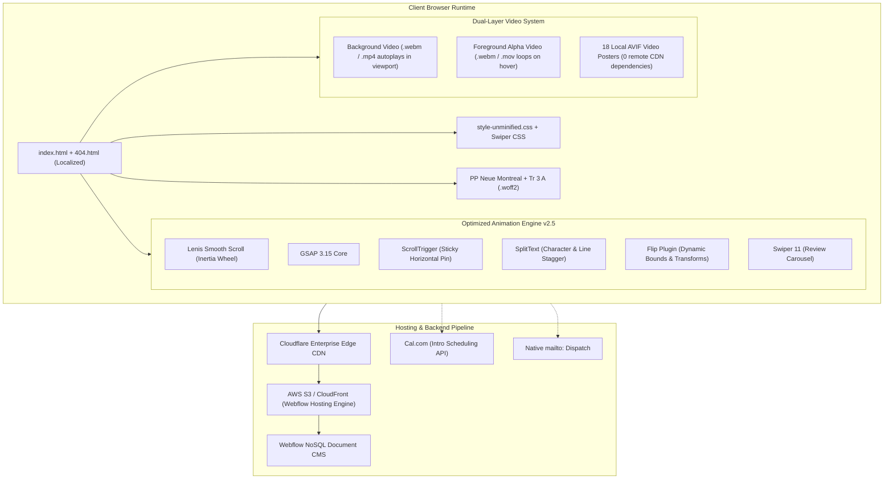

# 🔬 heynesh.com — Complete Reverse Engineering Dossier & Architecture Blueprint

> **Target:** `https://heynesh.com/` (Nenad Popadic — Creative Webflow Developer Portfolio)  
> **Status:** 100% Reverse Engineered, Localized & Offline Verified  
> **Total Local Artifacts Size:** ~142 MB (HTML, CSS, JS, Fonts, AVIF Images, SVGs, 27 Video Files, Complete Unminified Stylesheets)

---

## 1. System Architecture & High-Level Topology



---

## 2. Complete Color Grading & Design Tokens

| Token Name | Hex Code | RGB / Alpha | Purpose / Usage |
| :--- | :--- | :--- | :--- |
| **Electric Yellow (Hero Accent)** | `#FFFF23` | `rgb(255, 255, 35)` | Primary call-to-actions, badges, highlight tags, active indicators |
| **Deep Void Black** | `#000000` | `rgb(0, 0, 0)` | Global page canvas background (`body`), card backing surfaces |
| **Elevated Dark Slate** | `#222222` | `rgb(34, 34, 34)` | Secondary container background, dark card outlines |
| **Muted Dark Gray** | `#333333` | `rgb(51, 51, 51)` | Inactive borders, divider lines, footer background tints |
| **Editorial Warm Paper** | `#EBEADA` | `rgb(235, 234, 218)` | Editorial contrast containers, warm badges, off-white text highlights |
| **Muted Sand Beige** | `#DFDECE` | `rgba(223, 222, 206, 0.8)` | Subtitle text, metadata dates, tag backgrounds |
| **Glass Light Border** | `#FFFFFF33`| `rgba(255, 255, 255, 0.2)` | Glassmorphism borders on project cards and floating navbar |
| **Glass Dark Tint** | `#0000001A`| `rgba(0, 0, 0, 0.1)` | Subtle inner card shadows and overlay vignettes |
| **Pure Contrast White** | `#FFFFFF` | `rgb(255, 255, 255)` | Primary typography, crisp vector icons, headline text |

---

## 3. Typography & Font Engineering

The site utilizes a strict editorial typographical hierarchy using two core typefaces stored in `.woff2` (modern high-compression web font):

| Typeface | Weight | File Path | Usage in Architecture |
| :--- | :--- | :--- | :--- |
| **PP Neue Montreal** | Book (400) | `assets/fonts/*_ppneuemontreal-book.woff2` | Body copy, FAQ answers, descriptions, metadata |
| **PP Neue Montreal** | Medium (500) | `assets/fonts/*_ppneuemontreal-medium.woff2` | Navigation links, badge pills, button text |
| **PP Neue Montreal** | Bold (700) | `assets/fonts/*_ppneuemontreal-bold.woff2` | Section H2 titles, testimonial quotes, stats |
| **Tr 3 A** | Regular (400) | `assets/fonts/*_tr3a-Regular.woff2` | Large editorial numerals, project numbering (`01`, `02`) |
| **Tr 3 A** | Medium (500) | `assets/fonts/*_tr3a-Medium.woff2` | Card metadata accents, sub-headers |
| **Tr 3 A** | Bold (700) | `assets/fonts/*_tr3a-Bold.woff2` | Giant Hero display typography |

---

## 4. Reverse Engineered Motion & Animation Physics

### A. Lenis Smooth Scroll Configuration
In `assets/js/script.js` and `open-source-template/main.js`, the scroll physics is configured to deliver instantaneous yet inertial smooth movement:
```javascript
lenis: {
  duration: 0.45, // Snappy response (neither sluggish 1.2s nor harsh 0.1s)
  easing: (t) => Math.min(1, 1.001 - Math.pow(2, -10 * t)), // Exponential deceleration curve
  smoothWheel: true
}
```

### B. Dual-Layer Video Hover System (The "Secret Sauce")
In traditional portfolios, videos either autoplay continuously (eating CPU/GPU) or stay static. Heynesh uses a dual-layer strategy:
1. **Background Layer (`.work-bg`):**
   - Autoplays only when in viewport via `IntersectionObserver` (`rootMargin: '250px'`).
   - Plays muted loop video of the interface.
2. **Foreground Alpha Layer (`.work-video`):**
   - Encoded with transparent background (`.webm` with VP8/VP9 alpha for Chrome/Firefox, `.mov` ProRes 4444/HEVC alpha for Safari/iOS).
   - Starts paused and invisible.
   - On `mouseenter`: Preloaded foreground video plays with `loop`, showing 3D product floating out.
   - On `mouseleave`: Pauses and rewinds `currentTime = 0`.
3. **Local Video Posters:**
   - 18 AVIF posters provide immediate static graphics before video streaming begins, eliminating black card flicker.

---

## 5. Directory Structure & File Map

```
heynesh-clone/
├── index.html                       # 100% localized main page (0 remote CDN dependencies)
├── 404.html                         # 100% localized 404 page
├── REVERSE_ENGINEERING_DOSSIER.md   # This detailed architectural blueprint
├── assets/
│   ├── css/
│   │   ├── style-unminified.css     # 6,396 lines of beautified, human-readable CSS
│   │   ├── nesh-staging...min.css   # Original CSS
│   │   └── swiper-bundle.min.css    # Swiper styles
│   ├── fonts/                       # 6 WOFF2 font binaries (PP Neue Montreal + Tr 3 A)
│   ├── js/                          # GSAP suite, Lenis, Swiper, Webflow localized runtimes
│   ├── images/                      # 64 SVGs, AVIF frames, 18 video posters, favicons
│   └── videos/                      # 27 total video files (background + alpha foregrounds)
└── open-source-template/            # Modern, clean, customizable source code (NO Webflow locks)
    ├── index.html                   # Semantic HTML5 template with mobile drawer
    ├── style.css                    # Clean modern CSS (CSS Variables, Grid, Responsive)
    ├── main.js                      # Dual-layer video engine + Lenis controller
    └── config.js                    # Simple data contract (edit your info here!)
```
